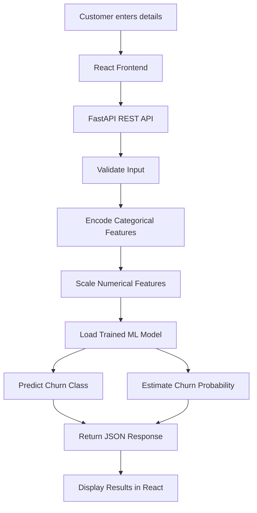

# ✦ Customer Churn Prediction

### Machine Learning · Predictive Analytics · Full-Stack Web Application

Predict customer churn probability using a trained Machine Learning model through a modern, interactive web application built with **Python, Scikit-learn, FastAPI, React, and Vite**.

Customer churn prediction helps businesses identify customers who may discontinue their services, enabling data-driven customer retention strategies.


<p align="center">
  
  
  
  
  
</p>

<p align="center">
  <strong>End-to-end ML inference · REST API · Interactive dashboard</strong>
</p>


---

## 📌 Table of Contents

- [Overview](#-overview)
- [Key Features](#-key-features)
- [Application Preview](#-application-preview)
- [How It Works](#-how-it-works)
- [Technology Stack](#-technology-stack)
- [Project Architecture](#-project-architecture)
- [Machine Learning Workflow](#-machine-learning-workflow)
- [API Documentation](#-api-documentation)
- [Installation and Setup](#-installation-and-setup)
- [Running the Application](#-running-the-application)
- [Input Features](#-input-features)
- [Future Improvements](#-future-improvements)
- [Contributing](#-contributing)
- [License](#-license)

---

## 🎯 Overview

Customer churn is a major challenge for subscription-based businesses, including telecommunications companies. Losing customers can affect revenue, customer lifetime value, and long-term business growth.

This project provides a machine learning-powered application that estimates the likelihood of a customer leaving a service based on customer demographics, subscription details, service usage, contract information, and billing data.

The application combines a trained classification model with a FastAPI backend and a React frontend to provide an interactive prediction experience.

### Project Objectives

- Predict whether a customer is likely to churn.
- Estimate churn probability using the trained classification model.
- Process customer input through a backend REST API.
- Apply the same encoding and scaling transformations used during model training.
- Present prediction results through a clean and responsive interface.
- Demonstrate the integration of Machine Learning with full-stack web development.

---

## ✨ Key Features

### 🤖 Machine Learning Prediction

- Binary classification of customer churn.
- Individual customer-level predictions.
- Estimated churn probability using the model's probability output.
- Pre-trained model loaded from a serialized Python file.

### 📊 Customer Assessment

- Personal and demographic information.
- Subscription tenure and service details.
- Internet, security, backup, and streaming services.
- Contract type and billing preferences.
- Monthly and total customer charges.

### ⚡ FastAPI Backend

- REST API for customer churn prediction.
- Pydantic-based input validation.
- Categorical feature encoding.
- Numerical feature scaling.
- JSON responses for prediction results and errors.
- CORS configuration for frontend integration.

### 🎨 React Frontend

- Modern customer assessment interface.
- Organized input sections.
- Interactive form controls.
- Loading and error states.
- Prediction result panel.
- Visual churn probability indicator.
- Responsive design for desktop and mobile devices.

---

## 🖥️ Application Preview

\<!-- Add your actual application screenshot here after capturing it. -->

\<p align="center">
&#x20; \<i>Capture your running application and upload the screenshot to this repository to showcase the interface here.\</i>
\</p>

**Recommended screenshot path:** `docs/images/dashboard.png`

After uploading the screenshot, replace the placeholder above with:

```html
<p align="center">
  
</p>
```

---

## 🔄 How It Works

The application follows a simple end-to-end prediction pipeline.



### Prediction Process

1. The user enters customer information in the React interface.
2. The frontend sends a JSON request to the FastAPI `/predict` endpoint.
3. FastAPI validates the request using the Pydantic input model.
4. Categorical values are transformed using the saved encoders.
5. Numerical features are scaled using the saved scaler.
6. The trained model generates a predicted class and churn probability.
7. The API returns the results as JSON.
8. The frontend displays the predicted outcome and estimated probability.

---

## 🛠️ Technology Stack

| Component           | Technology                    | Purpose                        |
| ------------------- | ----------------------------- | ------------------------------ |
| Frontend            | React                         | Interactive user interface     |
| Build tool          | Vite                          | Frontend development and build |
| Styling             | CSS                           | Responsive application design  |
| Backend             | FastAPI                       | REST API and prediction logic  |
| Validation          | Pydantic                      | Customer input validation      |
| Machine Learning    | Scikit-learn-compatible model | Churn classification           |
| Data processing     | Pandas                        | Tabular input preparation      |
| Model serialization | Pickle                        | Loading saved model artifacts  |
| API communication   | HTTP / JSON                   | Frontend-backend integration   |

---

## 📁 Project Architecture

The repository is organized into separate frontend and backend components.

```text
customer-churn-prediction/
│
├── backend/
│   ├── main.py
│   ├── churn_model.pkl
│   ├── scaler.pkl
│   ├── encoders.pkl
│   └── requirements.txt
│
├── frontend/
│   ├── src/
│   │   ├── App.jsx
│   │   ├── App.css
│   │   └── main.jsx
│   ├── package.json
│   └── vite.config.js
│
├── customer_churn_pred.ipynb
├── customer_churn_pred.py
├── .gitignore
└── README.md
```

> **Note:** This is the intended logical structure based on the project components. Adjust filenames and paths to match your actual repository. Keep large model artifacts out of Git if necessary, and provide instructions for obtaining them.

---

## 🧠 Machine Learning Workflow

The project uses a trained classification model to estimate customer churn.

### 1. Customer Data

The model receives structured customer features, including demographics, service subscriptions, contract details, and billing information.

### 2. Preprocessing

The backend applies the saved preprocessing objects:

- **Categorical encoding:** Converts supported categorical values into numerical representations.
- **Numerical scaling:** Transforms tenure and billing features using the saved scaler.

The transformations must match the preprocessing used when training the model.

### 3. Prediction

The backend generates two outputs:

```python
prediction = model.predict(df)[0]

probability = model.predict_proba(df)[0][1]
```

- `prediction`: The predicted class, where `0` represents no predicted churn and `1` represents predicted churn.
- `probability`: The model's estimated probability for class `1`.

The probability is converted to a percentage before being returned by the API.

**Important:** The model's predicted class and estimated probability are related but distinct outputs. Probability calibration and the classifier's decision rule affect their interpretation.

### 4. Model Evaluation

Model evaluation should include appropriate classification metrics, such as:

- Accuracy
- Precision
- Recall
- F1-score
- ROC-AUC
- Confusion matrix

Actual evaluation results should be added here after they have been calculated on a held-out test dataset.

---

## 🔌 API Documentation

The backend exposes a FastAPI application.

### Base URL

```text
http://127.0.0.1:8000
```

### Health Check

**Endpoint:** `GET /`

Example response:

```json
{
  "message": "Customer Churn Prediction API is running"
}
```

### Predict Customer Churn

**Endpoint:** `POST /predict`

**Content-Type:** `application/json`

Example request:

```json
{
  "gender": "Male",
  "SeniorCitizen": 0,
  "Partner": "No",
  "Dependents": "No",
  "tenure": 12,
  "PhoneService": "Yes",
  "MultipleLines": "No",
  "InternetService": "DSL",
  "OnlineSecurity": "Yes",
  "OnlineBackup": "No",
  "DeviceProtection": "No",
  "TechSupport": "Yes",
  "StreamingTV": "No",
  "StreamingMovies": "No",
  "Contract": "One year",
  "PaperlessBilling": "Yes",
  "PaymentMethod": "Electronic check",
  "MonthlyCharges": 65.5,
  "TotalCharges": 786.0
}
```

Example successful response:

```json
{
  "prediction": 0,
  "result": "Customer will Not Churn",
  "churn_probability": 18.42
}
```

*The response above is illustrative, not a verified prediction from the model.*

### API Response Fields

| Field               | Description                                           |
| ------------------- | ----------------------------------------------------- |
| `prediction`        | Predicted class (`0` or `1`)                          |
| `result`            | Human-readable prediction                             |
| `churn_probability` | Estimated churn probability as a percentage           |
| `error`             | Error details if the current backend returns an error |

### Interactive API Documentation

Once the backend is running, visit:

- Swagger UI: `http://127.0.0.1:8000/docs`
- ReDoc: `http://127.0.0.1:8000/redoc`

---

## 🚀 Installation and Setup

### Prerequisites

Install the following:

- Python 3.10 or a compatible version for your dependencies
- Node.js and npm
- Git

### 1. Clone the Repository

```bash
git clone https://github.com/JayP2006/customer-churn-prediction.git

cd customer-churn-prediction
```

### 2. Set Up the Backend

Open a terminal in the backend directory:

```bash
cd backend
```

Create a virtual environment:

```bash
python -m venv venv
```

Activate it on Windows:

```bash
venv\Scripts\activate
```

Activate it on macOS or Linux:

```bash
source venv/bin/activate
```

Install dependencies:

```bash
pip install fastapi uvicorn pandas scikit-learn
```

Ensure the saved model and preprocessing files are available:

```text
churn_model.pkl
scaler.pkl
encoders.pkl
```

If the repository provides a `requirements.txt`, use:

```bash
pip install -r requirements.txt
```

**Important:** Use compatible dependency versions and trusted model files. Pickle files can execute arbitrary code during loading, so never load untrusted artifacts.

### 3. Set Up the Frontend

Open a second terminal:

```bash
cd frontend
npm install
```

---

## ▶️ Running the Application

### Start the Backend

From the backend directory:

```bash
uvicorn main:app --reload
```

The API should be available at:

```text
http://127.0.0.1:8000
```

### Start the Frontend

From the frontend directory:

```bash
npm run dev
```

Open the local URL printed by Vite, usually:

```text
http://localhost:5173
```

Ensure the frontend API URL, backend CORS settings, model artifacts, encoders, and scaler are correctly configured before generating predictions.

---

## 🔍 Input Features

The application accepts the following customer information.

| Category          | Features                                                                          |
| ----------------- | --------------------------------------------------------------------------------- |
| Demographics      | Gender, senior citizen, partner, dependents                                       |
| Subscription      | Tenure, phone service, multiple lines                                             |
| Internet services | Internet service, online security, online backup, device protection, tech support |
| Entertainment     | Streaming TV, streaming movies                                                    |
| Contract          | Contract type, paperless billing, payment method                                  |
| Billing           | Monthly charges, total charges                                                    |

The input values must use categories and data types supported by the model's preprocessing pipeline.

---

## 🗺️ Future Improvements

Potential improvements include:

- [ ] Add a model evaluation report with verified test metrics.
- [ ] Add model explainability using SHAP or another suitable method.
- [ ] Add batch predictions for multiple customers.
- [ ] Build customer retention recommendations based on validated insights.
- [ ] Add automated tests for API endpoints and input validation.
- [ ] Deploy the frontend and backend.
- [ ] Add a CI workflow for testing and code quality.
- [ ] Improve model monitoring and probability calibration.
- [ ] Document model training, dataset provenance, and reproducibility.

---

## 🤝 Contributing

Contributions, suggestions, and improvements are welcome.

1. Fork this repository.
2. Create a feature branch.
3. Implement your changes.
4. Test the application.
5. Open a pull request with a clear description.

Please avoid committing API keys, credentials, private datasets, or sensitive customer information.

---

## 📄 License

No license has been specified in this repository yet.

If you intend to make the project open source, consider adding an appropriate `LICENSE` file and updating this section accordingly.

---

## 👨‍💻 Author

**Jay Patel**

GitHub: [@JayP2006](https://github.com/JayP2006)

---

\<p align="center">
&#x20; \<b>Built to explore Machine Learning, predictive analytics, and full-stack application development.\</b>
\</p>

\<p align="center">
&#x20; If you find this project useful, consider giving the repository a ⭐.
\</p>
